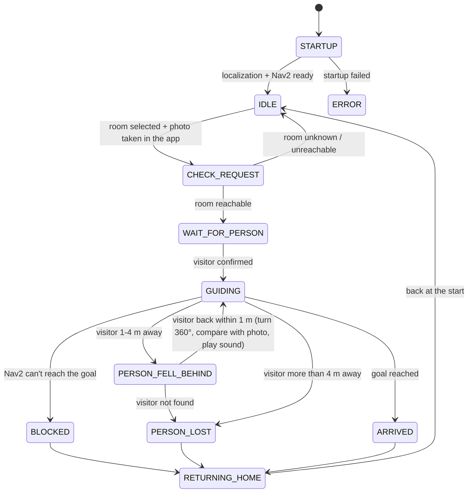

# How to install this project
## First install prerequisites
### First install Ubuntu 24.04 LTS either on a laptop or on wsl2
#### For WSL:
```bash
wsl --install -d Ubuntu-24.04
```

### Clone the repository to Documents
```bash
git clone https://github.com/GoTo-Diplomarbeit/ros2_nav.git ~/Documents/ros2_nav
```

### Run the setup.sh script

```bash
cd ~/Documents/ros2_nav/
chmod +x setup.sh

./setup.sh
```

The script also clones the simulator repository into `~/go2_ws/src/unitree_go2_ros2`
and builds both workspaces.

## Update to the newest version

When a teammate pushed something (to this repository or to the simulator repository), run:

```bash
cd ~/Documents/ros2_nav/
./setup.sh --update
```

It only does what is needed after an update, and skips the long installs:
1. pulls the newest version of this repository and of the simulator repository
   (the branch you are on in each),
2. rebuilds both workspaces (so new files, e.g. new worlds, are found),
3. downloads the Gazebo models the worlds use (so worlds start without internet later),
4. refreshes the PyCharm venv.

Pitfalls:
- It only pulls when that is safe. If it can't (no internet, uncommitted changes in the
  same files, or new commits both on your branch and on GitHub), it prints a WARNING and
  continues with your local version. Pull in PyCharm (Git → Pull), then run it again.
- A branch that exists only on your computer is not updated.
- `--update` needs one finished full `./setup.sh` run first.

# Choosing a Gazebo world (map)

The simulator can start with different Gazebo worlds. The worlds are `.sdf` files in the
simulator repository (cloned by `setup.sh` to `~/go2_ws/src/unitree_go2_ros2`):

```
~/go2_ws/src/unitree_go2_ros2/unitree_go2_description/worlds/
```

| World                | What it contains                                                    |
|----------------------|---------------------------------------------------------------------|
| `default`            | School entrance mockup (used when you don't pick a world)           |
| `school_with_person` | Same school mockup + a standing person 2 m in front of the robot    |

## Start the simulator with one world

Pass the world's file name (without `.sdf`) as `world:=`:

```bash
ros2 launch unitree_go2_sim unitree_go2_launch.py world:=school_with_person
```

The helper scripts take the same argument:

```bash
# Simulator only
scripts/launch_gazebo_with_lidar.sh world:=school_with_person

# Simulator + SLAM + Nav2 + teleop: first argument = SLAM backend, second = world
scripts/run_sim_mapping.sh rtabmap school_with_person
```

A full path to any `.sdf` file works too: `world:=/home/<you>/my_world.sdf`.

## Add a new world

1. Copy an existing world in the folder above, e.g. `cp default.sdf my_world.sdf`, and edit it.
2. Rebuild, otherwise the new file is not found: `./setup.sh --update`
   (or only the world package:
   `cd ~/go2_ws && PYTHONNOUSERSITE=1 colcon build --symlink-install --packages-select unitree_go2_description`).
3. Start it with `world:=my_world`.

Pitfalls:
- If you misspell the name, the launch stops and prints the list of available worlds.
- The robot always spawns at x=0, y=0 facing +x. Keep that spot free in new worlds
  (or move the robot with `world_init_x:=`, `world_init_y:=`, `world_init_heading:=`).
- `school_with_person` uses a person model from Gazebo Fuel (online model library).
  `setup.sh` downloads it into `~/.gz/fuel`; if that didn't happen, the first start of
  the world downloads it and needs internet.

# How the mission state (state machine) works

The robot is always in exactly **one mission state**, e.g. `IDLE` (waiting for a
destination) or `GUIDING` (walking a visitor to a room). Each node (camera, vision,
movement, ...) uses the state to decide whether it should work right now. Example: the
person tracking only has to run while the dog is guiding someone.

## The idea in three sentences

1. **One node owns the state:** the **state node** (`go2_nav/state/state_node.py`). It is
   the only node allowed to change it.
2. **It announces the state to everyone** on the topic `/mission_state`: right away when
   it changes, and once per second even when nothing changes (the "heartbeat").
3. **All other nodes only listen.** They never set the state themselves; they *ask* the
   state node for a change on `/mission_state_request`.

```
                    /mission_state_request  ("please switch to GUIDING")
   any node / you  ──────────────────────────►  state node  (owns the state)
                                                     │
                                                     │ /mission_state  (on change + every 1 s)
                       ┌─────────────────┬───────────┴─────┬─────────────────┐
                       ▼                 ▼                 ▼                 ▼
                 movement_node      vision_node      planner_node      camera_node
                 (only listen and react - via NodeWrapper)
```

Why one owner: if several nodes could change the state, two of them could set
different states at the same time, and nobody would know which one is right.

## All states

All states are defined in one place: `go2_nav/state/mission_state.py` (`class State`).

| State                | Meaning                                                     |
|----------------------|-------------------------------------------------------------|
| `STARTUP`            | Just started, waiting for localization and Nav2             |
| `IDLE`               | Standing, waiting for a destination from the app            |
| `CHECK_REQUEST`      | Checking: is the destination known and reachable?           |
| `WAIT_FOR_PERSON`    | Waiting until the visitor is ready to go                    |
| `GUIDING`            | Walking to the destination with the visitor                 |
| `PERSON_FELL_BEHIND` | Paused, waiting for the visitor to catch up                 |
| `PERSON_LOST`        | The visitor has been gone for too long                      |
| `BLOCKED`            | Nav2 could not plan or reach the goal                       |
| `ARRIVED`            | Destination reached                                         |
| `RETURNING_HOME`     | Walking back to the start point                             |
| `EMERGENCY_STOP`     | Everything stopped, only a manual reset continues           |
| `ERROR`              | Startup failed, only a manual restart continues             |

## The planned flow

This is how the states are meant to follow each other. It follows the project's
flowchart (`Flussdiagramm.png` in `Diplomarbeit-Unterlagen`).



From **every** state there is also a way to `EMERGENCY_STOP` (left out above to keep it readable).

> **Current status:** this flow is the *plan*. The state node does **not enforce it
> yet**: it accepts any valid state you request. The rules (which state may follow
> which) and the events that trigger them (the app sends a room, the lidar loses the
> visitor, ...) are the next step and will live in the state machine.

## What happens inside a node (NodeWrapper)

Every node inherits from `NodeWrapper` (`go2_nav/node_utils/node_wrapper.py`). It does
the listening for the node, so a node only has to say **in which states it works**:

```python
from go2_nav.node_utils.node_wrapper import NodeWrapper
from go2_nav.state.mission_state import State


class PersonTrackerNode(NodeWrapper):
    # 1. In which states should this node work?
    active_states = frozenset({State.GUIDING, State.PERSON_FELL_BEHIND})

    def __init__(self):
        super().__init__("person_tracker", self._setup_channels)

    def _setup_channels(self):
        ...  # create publishers / subscriptions here (required, like in every node)

    # 2. The work itself. Called every 0.1 s, but ONLY in one of the states above.
    def _run(self):
        ...  # e.g. check where the visitor is

    # 3. Optional: called once when a state starts / ends.
    def on_state_enter(self, state):
        if state == State.GUIDING:
            ...  # e.g. switch the camera on

    def on_state_exit(self, state):
        if state == State.GUIDING:
            ...  # e.g. switch the camera off
```

Inside the node you can read the current state with `self.state`, and ask
`self.is_active()` whether the node should be working right now.

**Safety net:** if the state node crashes, the heartbeat stops. After **2 s** without a
message, every node treats the state as *unknown* (`self.state = None`). Then `_run()` is
no longer called and `on_state_exit()` runs, so the nodes stop their work instead of
continuing with an old state.

**Late joiners:** a node that starts (or restarts) later still gets the current state
immediately. The last message is stored for it (QoS `TRANSIENT_LOCAL`), so it doesn't
have to wait for the next heartbeat.

Pitfalls:
- The state check only protects `_run()`. Subscription callbacks (e.g. "new camera
  image") are called in **every** state. Add `if not self.is_active(): return` at the top
  of a callback if it should only work in the active states.
- **Never** put a safety function behind the state check (e.g. "stop" in the movement
  node). A stop must always work.
- `_run()` must finish quickly. A node runs on one thread, so a slow `_run()` delays all
  of the node's other callbacks.
- Only the state node may publish on `/mission_state`. Other nodes use `/mission_state_request`.

## Try it out from a terminal

The state node is started by `bringup.launch.py`. To try it on its own:

```bash
# Terminal 1: start the state node
ros2 run go2_nav state_node

# Terminal 2: watch the current state (prints it once per second)
ros2 topic echo /mission_state

# Terminal 3: ask for a new state - terminal 2 shows the change,
# terminal 1 logs "Mission state: STARTUP -> GUIDING"
ros2 topic pub --once /mission_state_request std_msgs/msg/String "data: GUIDING"
```

A misspelled state (e.g. `"data: GUIDNG"`) is ignored, and the state node prints the
list of valid states.
